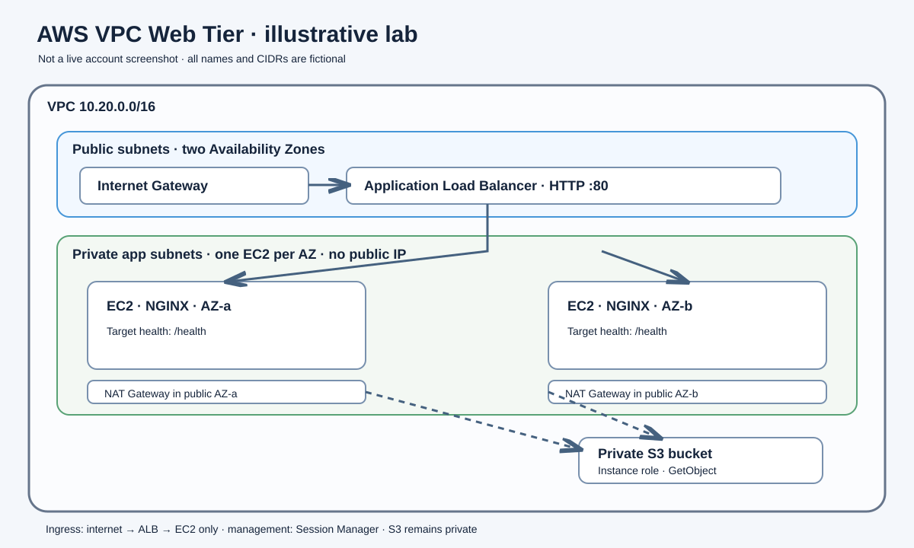
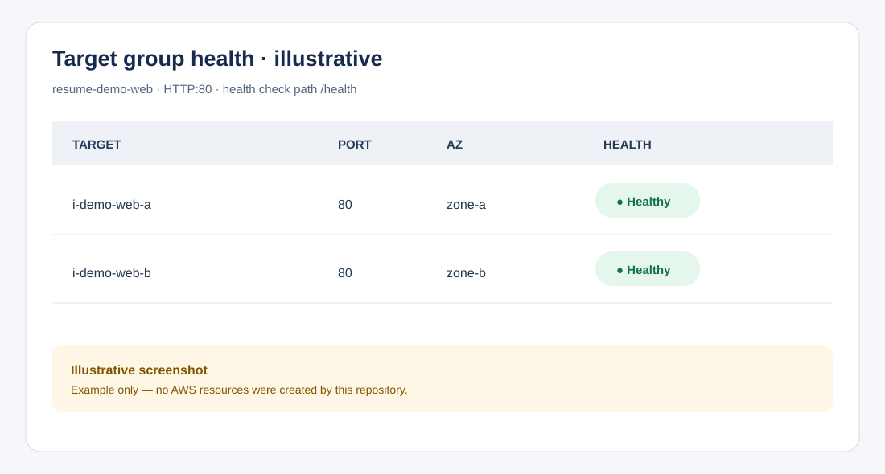

# AWS VPC Web Tier: ALB, EC2, NGINX and S3

A hands-on, **manual AWS Console** lab showing a public application load balancer distributing requests to NGINX web servers on EC2 instances in private subnets. A private S3 bucket holds sample static content. This repository documents a fictional learning environment: it does not contain AWS credentials, account identifiers, or real cloud screenshots, and it does not provision infrastructure automatically.



> The included architecture and console-style screenshots are clearly labeled illustrations. They represent the intended lab layout, not proof of resources deployed in an AWS account.

## Project goals

- Build a custom VPC with public and private subnets across two Availability Zones.
- Accept web traffic through an internet-facing Application Load Balancer (ALB).
- Keep EC2 instances private and run NGINX on each instance.
- Store a sample static file in private S3 and retrieve it from the instances using an instance role.
- Validate health checks and traffic distribution, then remove every resource.

## Services and tools

Amazon VPC, subnets, route tables, Internet Gateway, NAT Gateways, security groups, EC2 (Amazon Linux), IAM role and instance profile, Application Load Balancer, target group, S3, Systems Manager Session Manager, NGINX, and the AWS Management Console.

## Lab topology

| Component | Example configuration | Exposure |
|---|---|---|
| VPC | `10.20.0.0/16`, DNS support and hostnames on | Private address space |
| Public subnets | `10.20.1.0/24` and `10.20.2.0/24`, distinct AZs | ALB and NAT gateways |
| Private app subnets | `10.20.11.0/24` and `10.20.12.0/24`, distinct AZs | EC2 only |
| ALB | Internet-facing, HTTP listener on port 80 | Public DNS name |
| Target group | Instance targets, HTTP port 80, `/health` check | Registered EC2s |
| EC2 | Two small Amazon Linux instances, NGINX, no public IP | Private subnets |
| S3 | Private bucket, Block Public Access enabled | EC2 instance role only |

Use a unique bucket name in your account and select the same region for all resources. Availability Zone names can map to different physical zones across accounts; choose two available AZs in your region.

## Manual build guide

### 1. Create the network

In **VPC → Your VPCs → Create VPC**, create `resume-demo-vpc` with IPv4 CIDR `10.20.0.0/16`; enable DNS resolution and DNS hostnames. Create four subnets in two AZs using the CIDRs in the table. Name them `public-a`, `public-b`, `app-a`, and `app-b`.

Create and attach an Internet Gateway. Create a public route table, associate the two public subnets, and add `0.0.0.0/0 → Internet Gateway`. Create one NAT Gateway in each public subnet with an Elastic IP, then create a private route table per AZ, associate the matching app subnet, and route `0.0.0.0/0` to that AZ's NAT Gateway. The NAT routes allow package downloads while instances have no public address.

### 2. Create the S3 bucket and instance role

Create a uniquely named S3 bucket in the chosen region. Keep **Block all public access** enabled and leave object ownership as bucket owner enforced. Upload `sample/index.html` from this repository to the `site/` prefix.

In IAM, create an EC2 role named `resume-demo-ec2-role`, attach `AmazonSSMManagedInstanceCore`, and add a narrowly scoped inline policy allowing `s3:GetObject` on `arn:aws:s3:::YOUR-BUCKET-NAME/site/*`. Attach this role through an instance profile. Do not put access keys on an EC2 instance.

### 3. Configure security groups

- `alb-sg`: inbound TCP 80 from `0.0.0.0/0`; outbound TCP 80 to `web-sg`.
- `web-sg`: inbound TCP 80 **only from `alb-sg`**. Allow outbound TCP 443 for SSM and S3 access; allow required response traffic (security groups are stateful).

Keep SSH (22) closed. Use Systems Manager Session Manager to administer instances. For private S3 access without NAT data transfer, optionally create a regional S3 gateway endpoint and associate it with the private route tables; then constrain the bucket policy to that VPC endpoint if desired.

### 4. Launch two private EC2 web servers

Launch two Amazon Linux instances in different private app subnets. Select a current Amazon Linux AMI, small instance type appropriate for a short lab, the instance profile above, `web-sg`, and **disable auto-assign public IP**. Enable detailed monitoring only if needed. Add a `Name` tag for each server.

Connect with Session Manager and run the following on **each** instance. Replace the bucket placeholder with your bucket name:

```bash
sudo dnf install -y nginx awscli
sudo systemctl enable --now nginx
echo "<h1>Resume Demo</h1><p>Served by $(hostname)</p>" | sudo tee /usr/share/nginx/html/index.html
echo "healthy" | sudo tee /usr/share/nginx/html/health
aws s3 cp s3://YOUR-BUCKET-NAME/site/index.html /tmp/s3-sample.html
```

If `aws s3 cp` fails, confirm the instance role, bucket region, object key, route to NAT or S3 endpoint, and bucket policy. This sample command demonstrates retrieval; copy the object into the web root only if you want the S3 content served directly.

### 5. Create the load balancer

Create an **internet-facing Application Load Balancer** in the VPC. Select both public subnets and `alb-sg`. Create an instance target group with HTTP port 80, VPC selection, and health check path `/health`; register both EC2 instances. Add an HTTP:80 listener forwarding to this target group. Wait until both targets report **Healthy**, then open the ALB DNS name in a browser and refresh to observe the hostname change.

For a real public deployment, add HTTPS with ACM, redirect HTTP to HTTPS, use a restrictive security policy, and consider AWS WAF. The HTTP-only listener here is for the short-lived demo.

## Verification

1. In EC2, verify each instance has no public IPv4 address and is in a private subnet.
2. In Target Groups, confirm both targets are healthy.
3. Load the ALB DNS address; each response should identify one of the two hosts.
4. Confirm the S3 object is not publicly accessible, then use the instance role to retrieve it from Session Manager.
5. Review VPC Flow Logs or ALB access logs as optional extensions.

## Screenshots and diagrams



These are original illustrative assets for the README, not captures from a live AWS account. Replace them with your own console screenshots after completing the lab; redact account IDs, public IPs, and identifying names before publishing.

## Cost and cleanup

NAT Gateways, load balancers, EC2, public IPv4 addresses, S3 requests, and data transfer can incur charges. Check current regional pricing before starting and keep the lab brief. To clean up, delete the ALB listener and ALB, target group, EC2 instances, NAT Gateways and release their Elastic IPs, S3 objects and bucket, IAM role/profile/policy, route tables, subnets, Internet Gateway, and VPC. Confirm no dependent resources remain in the account.

## Resume description

> Designed and manually deployed a two-AZ AWS web tier using a custom VPC, public and private subnets, an internet-facing ALB, private EC2 NGINX instances, health checks, IAM instance roles, and a private S3 bucket; validated routing and documented teardown.
